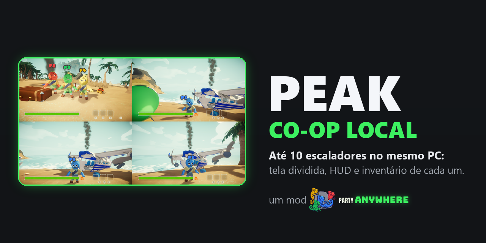

# PEAK Co-op Local

<p align="center"></p>

Até 10 escaladores no mesmo PC, no mesmo PEAK: cada um com a sua parte da tela (ou o celular), o próprio HUD,
a própria stamina, fome e frio, o próprio inventário e mochila. Todo mundo é um escalador de verdade da
expedição, como se tivesse entrado pela internet.

> **Em desenvolvimento.** Já funciona: até 10 escaladores de verdade no "Jogar sozinho", tela dividida, HUD,
> inventário, câmera e cor de cada um, abrir malas e pegar itens. Também: placas P1..P10, tela do jogo no
> celular, menus pelo controle, tela de fim e expedição salva para todos (estes três ainda sem teste completo). O estado de cada parte e o desempenho medido estão em
> [docs/PLANO-TECNICO.md](docs/PLANO-TECNICO.md). Em PC com vídeo integrado, 4 jogadores rodam a ~9 FPS: o
> próprio PEAK roda a ~20 sozinho nessa máquina.

## Jogar

Precisa do **PEAK** (a sua cópia da Steam). O app acha sozinho ou deixa você escolher a pasta.

1. Instale o [Party Anywhere](https://github.com/joaocaioo/party-anywhere/releases/latest) (ele avisa quando há versão nova).
2. Na Biblioteca, em **Adicionar jogo → Por link**, cole `https://github.com/party-anywhere/peak-coop`.
3. Conecte os controles ou escaneie o QR com o celular e aperte **Jogar**.

Com um agente de IA (Claude e outros), é só pedir *"instale este mod no Party Anywhere"* com o link deste repositório: o `AGENTS.md` diz a ele o que fazer (conferir o app, instalar se faltar e levar o mod para a sua Biblioteca).

### Controles

| Botão | Ação | Botão | Ação |
|---|---|---|---|
| Analógico esquerdo | Andar | Analógico direito | Olhar |
| A | Pular | B | Agachar |
| X | Usar / pegar | Y | Soltar item |
| RT | Agarrar / escalar | LT | Usar item (comer, etc.) |
| LB (ou clicar o esquerdo) | Correr | RB | Marcar (ping) |
| Clicar o direito | Emotes | Direcional ◀ ▶ / ▼ / ▲ | Trocar item / guardar / mochila |
| Start | Pausa | | |

## Como este mod funciona

- **Uma cópia do jogo**, com todos os escaladores dentro dela e uma visão por escalador (`pa docs coop`).
- Carregado pelo **BepInEx 5** (vai no pacote; LGPL-2.1). Nenhum arquivo original do jogo é trocado.
- A partida é a do modo **sozinho** do PEAK (Photon offline): cada pessoa do sofá vira um *ator virtual*
  na sala, então inventário, aflições, fogueiras, reviver e o fim da expedição contam com todos.
- Os jogadores chegam pelo SDK do Party Anywhere (`sdk/csharp/PartyAnywhere.cs`); o mod não lê o teclado nem
  os controles do Windows para quem está no lobby.
- Versão suportada: PEAK 3.0.1 (`acceptedSha256` na ficha). Conquistas ficam só com a conta de quem hospeda.

## Desenvolver

```powershell
powershell -File scripts\fetch-bepinex.ps1   # uma vez: BepInEx fixo na versão e no hash em vendor\
dotnet build src -c Release                  # compila contra o PEAK instalado (-p:PeakDir="..." para outra pasta)
powershell -File scripts\dev-install.ps1     # copia para a pasta do jogo (-Remove tira tudo)
```

Log do jogo: `PEAK\BepInEx\LogOutput.log`. Para testar sem controles de verdade, com o Hub aberto:
`pa phone-sim --players 4 --screen --save-view prints`.

- `powershell -File scripts\release.ps1` compila, confere e empacota em `release\`; `pa add .` leva para o seu Hub sem publicar.
- Com `-Publicar`, cria o release `vX.Y.Z` (igual ao `version` do `party-anywhere.json`) no GitHub. O build não roda no GitHub Actions porque precisa do jogo instalado.
